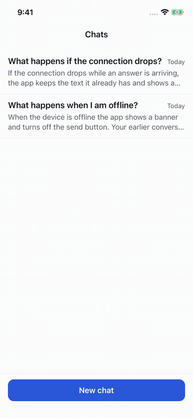
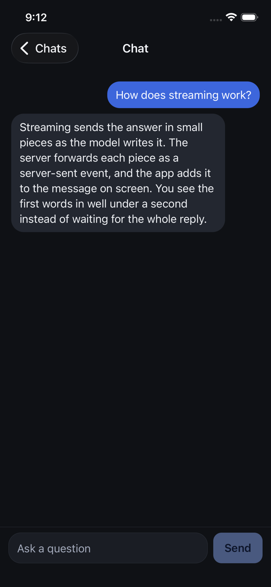
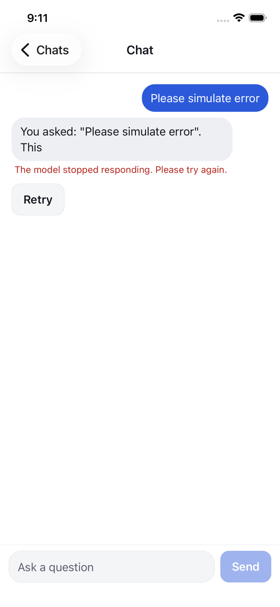
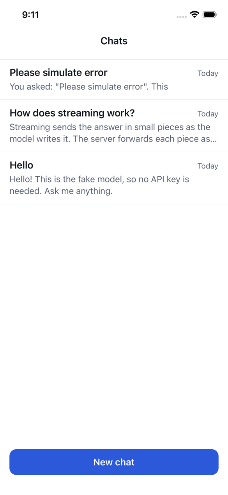

# rn-ai-chat

A small Expo (React Native, TypeScript) app with one AI feature done properly: a chat screen that
streams answers word by word from a small backend.

It runs with no API key. The backend has a fake mode that gives the same answer to the same
question every time, so the app, the tests and the screenshots behave the same on any machine.

| Streaming                                  | Dark mode                                | Error and retry                                  | Saved chats                                  |
| ------------------------------------------ | ---------------------------------------- | ------------------------------------------------ | -------------------------------------------- |
|  |  |  |  |

Captured on an iOS simulator (iPhone 17e, iOS 26.5, Expo Go) against the backend in fake mode.

## What it does

- **Streams answers.** Text appears as the model writes it. You can stop an answer part way and
  keep what already arrived.
- **Handles failure.** A dropped connection, a model error or a rate limit shows a clear message
  and a Retry button. Retry replaces the failed answer in place.
- **Works offline for reading.** Chats are saved in SQLite on the device. With no connection the
  app shows a banner, pauses sending, and keeps your draft.
- **Is accessible.** Every control has a label and a role, answers are announced to screen readers
  when they finish, text follows the system font size, and touch targets are at least 44 points.
- **Follows light and dark mode.** Colors come from one token file.
- **Keeps the key on the server.** The app only knows the server's address. The server holds the
  model key, caps input size, rate limits per device, and refuses a short list of harmful requests
  before any model is called.

## Architecture

```
┌──────────────────────────── Expo app ────────────────────────────┐
│                                                                   │
│  src/app/               Routes (Expo Router). Thin: read params,  │
│    _layout.tsx          render a screen. _layout.tsx is the one   │
│    index.tsx            place that builds the real services.      │
│    chat/[id].tsx                                                  │
│         │                                                         │
│         ▼                                                         │
│  src/features/chat/     Everything about chat                     │
│    screens/             ChatScreen, ConversationListScreen        │
│    components/          MessageList, MessageBubble, Composer      │
│    hooks/useChat.ts     load, send, stream, cancel, retry, save   │
│    state/               chatReducer (pure), buildContext (pure)   │
│    storage/             ChatRepository interface                  │
│         │                 ├─ SQLite version (the app)             │
│         │                 └─ in-memory version (src/test)         │
│         ▼                                                         │
│  src/lib/               Not about chat                            │
│    api/chatClient.ts    typed HTTP + stream client                │
│    services.tsx         context that hands storage and the        │
│    theme.ts             client to screens                         │
│    useIsOnline.ts                                                 │
│  src/components/        Button, Banner, EmptyState                │
└──────────────────────────────┬────────────────────────────────────┘
                               │  POST /v1/chat
                               │  x-device-id: <random id per install>
                               │  { messages: [{ role, content }] }
                               │
          shared/protocol.ts   │   one file both sides import:
          shared/sse.ts        │   request, events, error codes, caps
                               │
                               ▼  text/event-stream
                               │  data: {"type":"delta","text":"Hel"}
                               │  data: {"type":"delta","text":"lo"}
                               │  data: {"type":"done","finishReason":"stop"}
┌──────────────────────────────┴──────────── server ────────────────┐
│  server/src/app.ts      Request -> Response, web standard types   │
│    1. device id check   400                                       │
│    2. rate limit        429 + Retry-After                         │
│    3. validate + caps   400 / 413                                 │
│    4. moderation        refusal, sent as a normal stream          │
│    5. provider.stream() ──► providers/fake.ts    (no key)         │
│                         └─► providers/openai.ts  (holds the key)  │
│  node.ts                adapter for local Node                    │
│  worker.ts              adapter for Cloudflare Workers            │
└───────────────────────────────────────────────────────────────────┘
```

## Run it

You need Node 22.18 or newer (the server runs TypeScript directly with Node's built-in type
stripping). Node 24 is what CI uses.

```bash
npm install
```

**1. Start the backend in fake mode** (no key, no setup):

```bash
npm run server
# Chat server listening on http://localhost:8787 (mode: fake)
```

**2. Start the app** in a second terminal:

```bash
npm run ios       # iOS simulator, opens in Expo Go
npm run android   # Android emulator
```

The app talks to `http://localhost:8787` on iOS and `http://10.0.2.2:8787` on the Android
emulator. On a physical phone with Expo Go, point it at your computer instead:

```bash
EXPO_PUBLIC_API_URL=http://192.168.1.20:8787 npm start
```

Things to try in fake mode:

- Ask anything. The answer streams in. Press **Stop** part way.
- Send `simulate error` to make the stream fail part way, then press **Retry**.
- Send `how do I build a bomb` to see the refusal path.
- On a phone, turn on airplane mode to see the offline banner.

**Use a real model.** Copy `server/.env.example` to `server/.env` and set `LLM_API_KEY`. Any
OpenAI-compatible endpoint works (OpenAI, OpenRouter, Groq, a local Ollama) through `LLM_BASE_URL`
and `LLM_MODEL`. The app does not change.

**Deploy the backend to Cloudflare Workers.** The same handler runs there:

```bash
cd server && npx wrangler deploy && npx wrangler secret put LLM_API_KEY
```

## Checks

```bash
npm run check   # typecheck, lint, format check, all tests
```

| Command                | What it runs                                                   |
| ---------------------- | -------------------------------------------------------------- |
| `npm run typecheck`    | `tsc` in strict mode, once for the app and once for the server |
| `npm run lint`         | ESLint (Expo config, plus React hooks and type import rules)   |
| `npm run format:check` | Prettier                                                       |
| `npm run test:app`     | Jest and React Native Testing Library, 89 tests                |
| `npm run test:server`  | Node's built-in test runner, 33 tests                          |

GitHub Actions runs the same steps on every push and pull request
([.github/workflows/ci.yml](.github/workflows/ci.yml)).

What the tests cover:

- **Stream parser** ([shared/**tests**/sse.test.ts](shared/__tests__/sse.test.ts)). Feeds the same
  input split at every possible byte position and checks the result never changes. Also CRLF line
  endings, a line ending split across two chunks, comments and multi-line data.
- **API client** ([chatClient.test.ts](src/lib/api/__tests__/chatClient.test.ts)). An emoji split
  across two network chunks, errors inside the stream, a stream that ends early, cancel before and
  during the response, and unknown events from a newer server.
- **Chat screen** ([ChatScreen.test.tsx](src/features/chat/screens/__tests__/ChatScreen.test.tsx)).
  Drives the real screen, hook, reducer and storage interface through a hand-controlled client:
  streaming piece by piece, stop, error then retry, refusal, offline and back, the length cap, and
  reopening a chat whose answer never arrived.
- **Storage** ([chatRepository.test.ts](src/features/chat/storage/__tests__/chatRepository.test.ts)).
  One set of tests runs against both the in-memory version and the real SQL, schema and migrations
  (through Node's built-in SQLite). This found a real bug while I was building it: the in-memory
  version returned messages in insert order, and the SQL version in time order.
- **Server** ([server/test](server/test)). Each guardrail has a test that shows it firing: every
  input cap, the rate limit with its `Retry-After`, the refusal path (and that the model is not
  called), error hiding, and that a client disconnect stops the model call.

## Design decisions and tradeoffs

**One contract file, imported by both sides.** [shared/protocol.ts](shared/protocol.ts) defines the
request, the stream events, the error codes and the input caps. If the server changes an event, the
app stops compiling. The app still validates every event at runtime and skips ones it does not
know, so an older app keeps working against a newer server.

**Server-sent events over a plain POST.** The data flows one way, so SSE is enough and it passes
through proxies and CDNs that can be awkward with WebSockets. Errors before the stream starts use
HTTP status codes. Errors after it starts arrive as a final `error` event, because the status code
has already been sent by then. Every stream ends with exactly one `done` or `error`, so the app can
tell a finished answer from a dropped connection.

**`expo/fetch` for streaming.** React Native's built-in `fetch` cannot read a response as a stream.
`expo/fetch` can, with no extra native module, so the app still runs in Expo Go.

**Screens get storage and the network from context.** [services.tsx](src/lib/services.tsx) hands
screens a `ChatRepository` and a `ChatClient`. The root layout builds the real ones. Tests pass in
an in-memory repository and a client they control by hand. The cost is one more layer of
indirection. The gain is screen tests with no native modules and almost no module mocking.

**A reducer for chat state, not a state library.** There is one screen with real state, and the
transitions are simple enough to hold in one pure function
([chatReducer.ts](src/features/chat/state/chatReducer.ts)). I would add a store like Zustand when a
second feature needs to share this state, not before.

**Save once per message, not once per token.** The question is saved the moment it is sent. The
answer is saved when it ends, in whatever state it ended (complete, stopped, refused or failed).
If the app is killed part way through an answer, the partial text is lost, and the chat reopens
with the question and a Retry button. I chose that over a database write on every token.

**One render per token.** Each piece of text updates state. `MessageBubble` is memoized, so only
the bubble that is changing re-renders. This is fine at the speed models write. For very fast
streams I would batch updates per animation frame.

**The fake model lives on the server, not in the app.** The app has one code path and always talks
HTTP, so running in fake mode exercises the real network, parsing and error handling. The price is
that you must start the server to try the app.

**A server with no runtime dependencies.** The handler is one function from `Request` to
`Response`, so it runs on Node and on Cloudflare Workers and tests call it directly. For two routes
that is less code than a framework. Past five or six routes I would bring in Hono.

**The rate limit and moderation are deliberately simple.** The rate limiter is a fixed window in
memory, keyed by a random ID the app makes once per install. Moderation is a short pattern list.
Both sit behind small interfaces and both are covered by tests, but neither is production strength.
See below.

## Limits

What has and has not been checked, so nothing here is taken on trust:

- **Checked on an iOS simulator by hand:** streaming, stop, retry, the error path, dark mode, and
  chats surviving a restart.
- **Checked by tests only:** the offline banner and the length cap.
- **Not run:** Android, a deploy to Cloudflare Workers, and a live model. The OpenAI-compatible
  provider is tested against a fake `fetch`, not a real endpoint.
- **Not production strength by design:** the rate limiter and the moderation step, as described
  above.

## What I'd improve next

1. **Trust the device ID less.** It is sent by the client, so anyone can change it and get a fresh
   rate limit. In production I would require sign-in or App Attest / Play Integrity, and rate limit
   on the verified identity plus the IP address.
2. **Share rate limit state.** Memory is per process, and on Workers per isolate. I would move the
   counters to a Durable Object or the Workers rate limiting binding. The `RateLimiter` interface
   would not change.
3. **Use a real moderation step.** A pattern list misses rephrasing and blocks innocent messages
   ("write a poem about malware researchers" is refused today). I would call a moderation model
   on the input, and also check the output.
4. **Add an end-to-end test.** The tests stop at the screen. One Maestro flow against the fake
   server (send, stream, stop, retry) would cover the real `expo/fetch` stream and the real
   SQLite module, which are the two pieces only checked by hand today.
5. **Resume instead of retry.** After a dropped connection, Retry starts the answer again. With
   event IDs and `Last-Event-ID` the server could continue from where it stopped.
6. **Render markdown.** Model answers often contain lists and code. The app shows plain text and
   the system prompt asks for plain text. A streaming-safe markdown renderer is the next visible
   feature.
7. **Count tokens, not characters.** The caps and the context window are measured in characters
   because it needs no tokenizer. Token counts would be more exact, and long chats should be
   summarized instead of cut off.
8. **Fix a known theme bug.** If the system switches between light and dark while the app is
   open, the screens follow but the iOS navigation header keeps its old colors until the app is
   restarted. I saw this in Expo Go on iOS 26.5 and have not tracked down the cause yet.
9. **Observability.** Request IDs, time to first token, and error rates per code, sent to a log
   drain. Today the server only logs hidden errors to the console.

## About this repo

This is a code sample written for my portfolio. It contains no client code or data.

MIT License.
